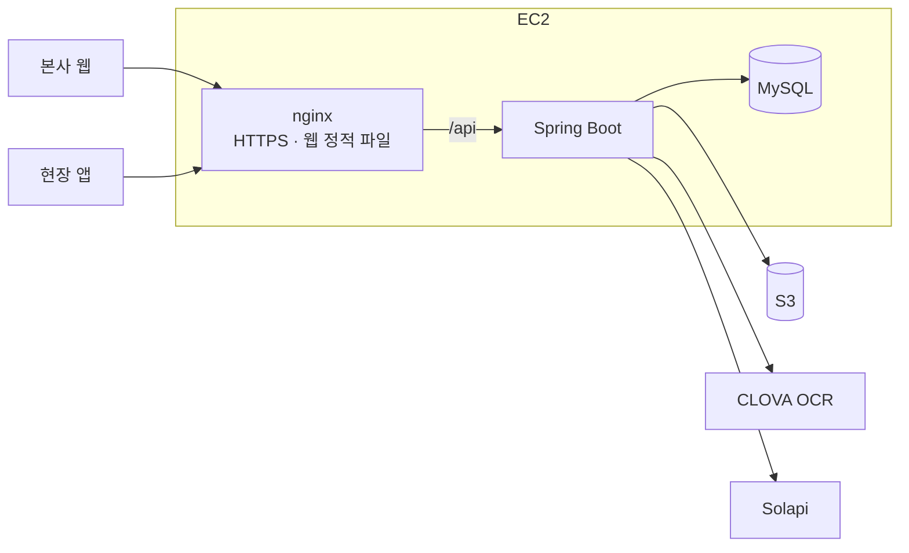

# The Labot Backend

건설 현장 근로자 투입부터 정산까지, 노무관리를 한 곳에서 처리하는 서비스의 API 서버.

[프론트엔드](https://github.com/The-Labot/the-labot-frontend) · [조직 소개](https://github.com/The-Labot)

## 기술 스택

| 구분 | 기술 | 쓰임 |
|---|---|---|
| 애플리케이션 | Java 21, Spring Boot 3.5, Spring Security, JWT | API, 역할별 인가 |
| 데이터 | MySQL 8.0, Spring Data JPA | 현장·근로자·출퇴근·급여 저장 |
| 외부 서비스 | AWS S3, NAVER CLOVA OCR, Solapi | 파일 저장, 신분증·계약서 인식, 임시 비밀번호 문자 |
| 테스트 | JUnit 5, MockMvc, MySQL 8.0 | 주요 조회 API 스모크 테스트 |
| 인프라 | Docker Compose, EC2, Docker Hub, nginx·certbot | 배포, HTTPS |
| CI/CD | GitHub Actions | 빌드·테스트, 이미지 빌드 후 배포 |

## 운영 구성



- 웹·백엔드·DB 컨테이너가 EC2 한 대의 Docker 네트워크 하나에 있고, nginx가 `/api` 요청을 백엔드로 넘긴다.
- 인증서는 certbot 컨테이너가 12시간마다 갱신을 확인한다.
- `main`에 머지하면 GitHub Actions가 이미지를 Docker Hub에 올리고, EC2에서 compose로 새 이미지를 띄운다.

## API 구성

역할마다 경로를 나눠 Spring Security에서 인가한다.

| 경로 | 사용자 | 주요 기능 |
|---|---|---|
| `/api/admin/**` | 본사 | 현장 생성·수정, 현장 관리자 지정, 근로자·급여 관리, 현장별 대시보드 |
| `/api/manager/**` | 현장 관리자 | 근로자 등록(OCR), 공지, 안전교육, 위험 신고 처리, 작업일보, 현장 지도 |
| `/api/worker/**` | 근로자 | 출퇴근, 공지, 위험 신고, 현장 지도 |
| `/api/auth/**` | 비로그인 | 로그인, 본사 가입, 임시 비밀번호 발급 |
| `/api/user/**` | 로그인한 모든 역할 | 비밀번호 변경 |

## 주요 기능

- **근로자 등록**: 신분증·근로계약서 이미지를 CLOVA OCR로 읽어 이름·주민등록번호·계약 형태·급여·계좌 같은 등록 정보를 채운다.
- **출퇴근**: 앱에서 보낸 위치와 현장 좌표의 거리가 500m 안일 때만 기록한다.
- **급여**: 일별 공수를 월 단위로 합산하고, 일급·월급 단가에 4대보험·소득세·퇴직공제를 적용해 계산한다.
- **안전 관리**: 안전교육 참석 서명, 위험 신고 처리 상태, 작업일보의 자재·장비 기록.

## 배포·운영 개선

- 운영 설정에서 `open-in-view`를 끄다가, 전 근로자의 비밀번호 해시와 전화번호를 그대로 응답하던 API를 찾아 삭제했다([#171](https://github.com/The-Labot/the-labot-backend/pull/171)).
- CD의 빌드 캐시가 절약하는 시간(의존성 다운로드 24.5초)보다 캐시 전송 비용(다운로드 약 19초 + 업로드 33\~56초)이 커서 제거했다([#169](https://github.com/The-Labot/the-labot-backend/pull/169)).
- CI가 PR에서만 돌아 Gradle 캐시가 한 번도 저장되지 않던 원인을 고쳐, PR 실행의 캐시 관련 단계가 72초에서 41초로 줄었다([#176](https://github.com/The-Labot/the-labot-backend/issues/176)).
- CI가 테스트를 건너뛰던 것을 켜고, 운영과 같은 MySQL로 주요 조회 API 스모크 테스트를 돌린다([#175](https://github.com/The-Labot/the-labot-backend/pull/175)).

## 프로젝트 구조

```text
src/main/java/com/example/the_labot_backend/
├── authuser/       로그인, JWT, 임시 비밀번호 문자
├── headoffice/     본사
├── sites/          현장, 현장 관리자
├── workers/        근로자
├── ocr/            신분증·근로계약서 인식, 근로자 등록
├── attendance/     출퇴근
├── payroll/        급여
├── educations/     안전교육
├── hazards/        위험 신고
├── reports/        작업일보
├── notices/        공지
├── map/            현장 지도
├── files/          S3 파일
├── dashboard/      대시보드
└── global/         보안, 예외, 설정
```

## 로컬 실행

<details>
<summary>실행 방법</summary>

JDK 21과 Docker(Compose)가 필요하다.

```bash
cp .env.example .env                                # 쓰는 기능의 키만 채운다. 비워도 기동된다
docker compose -f docker-compose.local.yml up -d    # MySQL
./gradlew bootRun                                   # .env를 읽어 local 프로필로 기동
./gradlew test                                      # 로컬 MySQL에 테스트용 스키마를 따로 만든다
```

API 문서: http://localhost:8080/swagger-ui/index.html

</details>

## 팀원

| 이름 | 주요 담당 |
|---|---|
| 장근창 | 배포·운영 환경(Docker, CI/CD, HTTPS), S3 파일 저장, OCR 연동 |
| 방성식 | 백엔드 본사·현장·공지·안전교육·위험 신고·작업일보·인증, 본사 웹 화면 |
| 박찬홍 | 백엔드 근로자 관리·출퇴근·OCR 근로자 등록·대시보드 |
| 장동현 | 현장 앱(관리자·근로자 화면), 본사 웹 공통 컴포넌트 |
